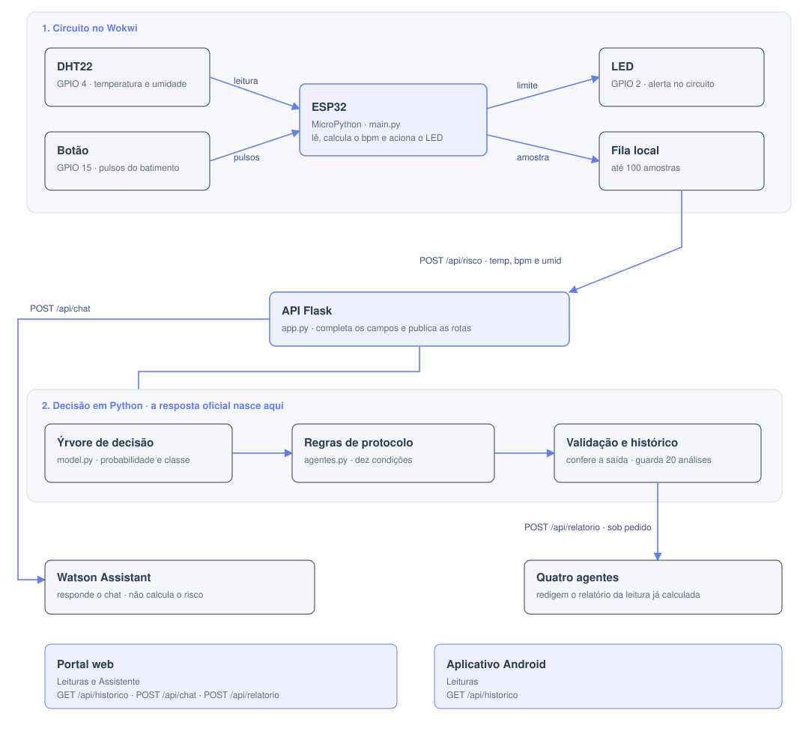

# CardioIA

Relatório técnico de arquitetura

FIAP — Faculdade de Informática e Administração Paulista

**Integrantes**

- Amanda Vieira Pires (RM566330)
- Ana Gabriela Soares Santos (RM565235)
- Bianca Nascimento de Santa Cruz Oliveira (RM561390)
- Milena Pereira dos Santos Silva (RM565464)
- Nayana Mehta Miazaki (RM565045)

**Tutor:** Caique Nonato da Silva Bezerra  
**Coordenador:** André Godoi

Os pacientes, os sinais e o modelo são simulados. O sistema não faz diagnóstico e não substitui avaliação clínica.

## 1. O que o projeto é

O CardioIA apoia a decisão de um serviço de cardiologia. Um sensor simulado mede temperatura, umidade e batimento. Uma API estima a chance de um pico de risco e indica quais protocolos operacionais se aplicam. O médico vê o resultado no portal e no aplicativo, e pode tirar uma dúvida no chat.

O pico de risco não é um diagnóstico de um paciente. Na base usada para treinar o modelo, ele significa que o serviço está sob pressão por pelo menos dois problemas ao mesmo tempo: fila, carga, oxigenação, frequência, volume de eventos ou falta de recursos.

## 2. Por que o sistema foi construído assim

O produto junta, numa aplicação só, resultados que o grupo já tinha produzido. Cada parte entra pelo que ela sabe fazer.

| Origem | O que entra nesta fase | Por que ficou neste lugar |
| --- | --- | --- |
| Monitoramento do sensor | Circuito com DHT22, botão e LED, fila local e envio quando o link volta | O hardware simulado mede três grandezas. Ele não classifica risco. |
| Modelo de risco | Árvore de decisão salva em `cardioia_modelo_risco.pkl` | A árvore já tinha sido treinada e comparada com a regressão logística. Aqui ela só é consultada. |
| Regras de protocolo | Dez condições escritas em código | Um limite clínico pede uma ação mesmo quando a árvore ainda não aponta pico. |
| Quatro agentes | Orquestrador, analista, especialista e planejador | Eles redigem o relatório da leitura. O número oficial continua sendo o da árvore. |
| Assistente de linguagem | Watson Assistant | O chat responde perguntas. Ele não calcula o risco da leitura. |
| Portal web | Login, leituras, assistente e clínica de exemplo | O médico consulta o que a API já avaliou. |

A separação evita que uma camada refaça o trabalho da outra. O sensor mede. A árvore estima o pico. As regras apontam a ação. O Watson conversa. Os agentes escrevem. As telas mostram.

## 3. Arquitetura

O circuito e o programa do sensor ficam em `iot/`. A API, o modelo e as regras ficam em `backend/`. O portal fica em `web/`. O aplicativo fica em `mobile/`. As chaves do Watson e da OpenAI ficam no ambiente do servidor, fora do Git.

## 4. O caminho de uma leitura

1. A cada 2 segundos o ESP32 lê temperatura e umidade no DHT22. O botão conta pulsos. A cada 5 segundos essa contagem vira batimentos por minuto: pulsos na janela multiplicados por 12. Sem pulsos, o batimento fica em 0.
2. O LED acende se a temperatura passa de 38 °C, o batimento passa de 120 ou a umidade passa de 90%. Esse aviso é local. A classe continua sendo decidida pela API.
3. A rede do simulador, `Wokwi-GUEST`, permanece ligada. O envio para a API é outra chave: começa desligado e troca a cada 15 segundos. Desligado, a amostra entra numa fila de até 100. Ligado, sai em `POST /api/risco` com `temp`, `bpm` e `umid`.
4. A API recusa número fora da faixa. O batimento precisa estar entre 0 e 250. Uma leitura recusada é descartada. Se a rede falha, a amostra continua na fila.
5. A API completa os dez campos do modelo, consulta a árvore, monta os protocolos e guarda a análise. O histórico tem no máximo 20 itens e vive na memória do processo. Quando o processo reinicia, a lista recomeça vazia.
6. Portal e aplicativo leem `GET /api/historico`. Em Leituras, o clique abre horário, temperatura, batimento, probabilidade, classe e protocolos.

## 5. Como a API decide

A leitura produz duas respostas, porque elas respondem perguntas diferentes.

A **classe** responde: este cenário se parece com um pico de risco da base de treino? A base tem 5.000 cenários simulados de um serviço. O rótulo vale 1 quando pelo menos duas destas situações ocorrem juntas:

- carga do sistema acima de 80%
- espera acima de 60 minutos
- saturação abaixo de 92%
- frequência cardíaca acima de 110 bpm
- mais de 4 eventos em 24 horas
- recursos disponíveis abaixo de 40%

A árvore devolve a probabilidade desse pico. Probabilidade associada ao pico vira **ALTO RISCO**. O restante vira **BAIXO RISCO**. Na base, a temperatura foi gerada em torno de 24 °C, como ambiente da simulação. Ela entra como dado e não faz parte das seis situações acima.

O **protocolo** responde: alguma regra operacional foi ultrapassada? Uma condição basta.

| Condição | Ação |
| --- | --- |
| Saturação abaixo de 88% | Suporte respiratório imediato |
| Carga acima de 85% | Abrir unidades temporárias |
| Frequência acima de 120 bpm | Monitoramento intensivo |
| Mais de 5 eventos em 24 h | Equipe de resposta rápida |
| Recursos abaixo de 30% | Redistribuir insumos |
| Espera acima de 90 minutos | Triagem emergencial |
| Temperatura acima de 38 °C | Protocolo infeccioso |
| Densidade de eventos acima de 6 | Plano de contingência |
| Pressão sistólica abaixo de 90 | Protocolo de choque |
| Classe ALTO RISCO | Estado de emergência |

Uma leitura com 132 bpm e os demais campos no cenário calmo permanece em **BAIXO RISCO**, porque só uma das seis situações do treino está presente. O protocolo de monitoramento entra, porque a frequência passou de 120.

Antes de gravar, a API confere três coisas: probabilidade entre 0 e 1, classe alto ou baixo risco, e protocolos numa lista de textos.

### O que o sensor mede e o que a API completa

O modelo usa dez campos. O sensor envia três. A umidade fica registrada na resposta e fica de fora do modelo. O valor padrão é um cenário calmo, para que um único sinal alterado não seja lido como pressão geral do serviço.

| Campo | Significado | Valor quando o sensor não envia |
| --- | --- | --- |
| `idade_media` | Idade média | 55 |
| `carga_sistema` | Ocupação do serviço, de 0 a 100 | 50 |
| `tempo_espera` | Espera em minutos | 30 |
| `fc_media` | Frequência cardíaca | 80, ou o `bpm` enviado |
| `spo2_media` | Saturação | 97 |
| `pa_sistolica` | Pressão sistólica | 120 |
| `temperatura` | Temperatura em °C | 24, ou o `temp` enviado |
| `densidade_eventos` | Concentração de eventos | 2 |
| `eventos_24h` | Eventos nas últimas 24 horas | 1 |
| `disponibilidade_recursos` | Recursos, de 0 a 100 | 70 |

## 6. Onde entra a inteligência artificial

Há dois usos, e os dois recebem um trabalho já delimitado.

**Watson Assistant.** A página Assistente envia a frase para `POST /api/chat`. Com as credenciais no servidor, a resposta vem do Watson. Sem elas, ou quando a IBM não responde, a API usa textos locais sobre sintomas de infarto, triagem e emergência, e lembra que o conteúdo é acadêmico. O Watson não vê a leitura do sensor e não altera a classe.

**Quatro agentes.** No detalhe de uma leitura, **Gerar relatório** chama `POST /api/relatorio`. O orquestrador encaminha o caso. O analista lê a probabilidade e a classe que a árvore já calculou. O especialista lê os protocolos que as regras já verificaram. O planejador escreve o texto: repete esses dados e acrescenta um parágrafo para o plantão. O sensor não dispara essa chamada. Várias leituras por minuto tornariam o relatório lento e caro, e o número da tela deixaria de ser estável.

## 7. O que cada tela faz

- **Leituras**, no portal e no aplicativo: lista o que o sensor enviou e a API avaliou. Atualizar busca as leituras novas. O clique abre o detalhe e, no portal, o pedido de relatório.
- **Assistente**, no portal: chat descrito na seção 6.
- **Pacientes, consultas e novo agendamento:** clínica de exemplo, com registros fixos. Essas telas não passam pela árvore.
- **Login**, nos dois lugares: `medico@cardioia.com` / `123456`. Libera a navegação. Não há cadastro de usuários.

## 8. Onde o sistema está no ar

| Parte | Endereço |
| --- | --- |
| API | https://chap01-phase07-cardioai.onrender.com |
| Portal | https://chap01-phase07-cardioai.vercel.app |
| Aplicativo | https://expo.dev/accounts/biancansantacruz/projects/cardioia/builds/0141d232-21a7-40b3-995e-1434833ed801 |
| Sensor | https://wokwi.com/projects/480298841772684289 |

A API confirma que está no ar em `GET /api/saude`. A raiz do servidor não tem página. No Android, o link do aplicativo baixa o APK do perfil `preview`.

A instância gratuita da API adormece sem uso. A primeira chamada pode levar cerca de um minuto, e a lista de leituras volta vazia depois que o processo reinicia.
